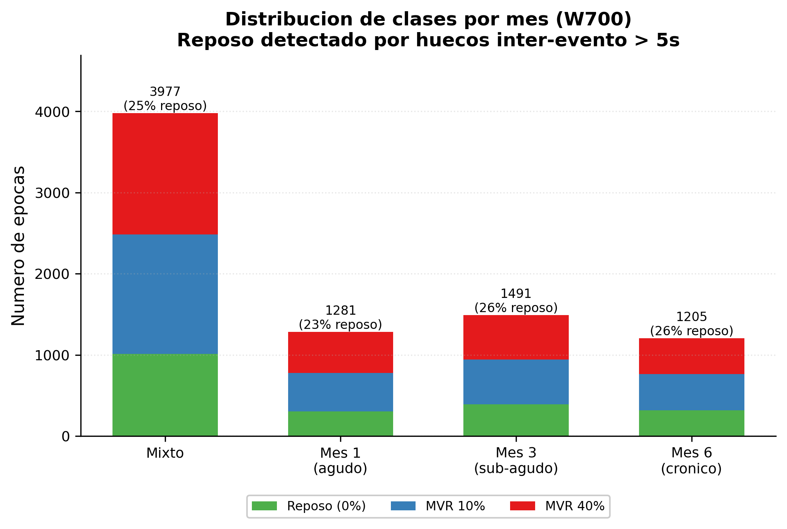
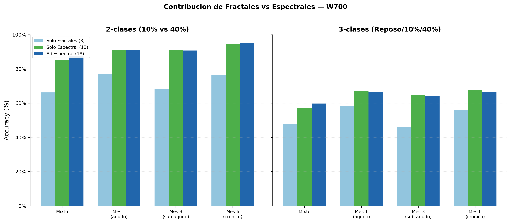
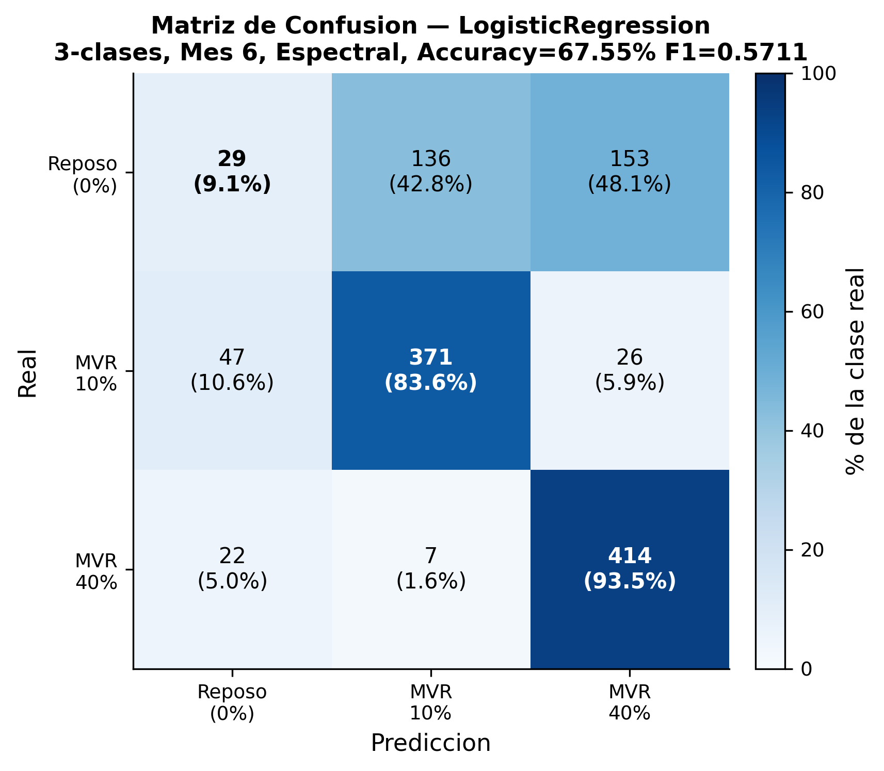
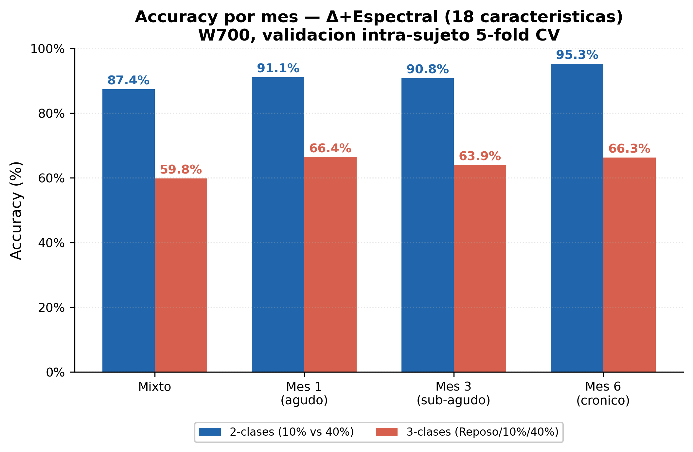

# Clasificacion de Niveles de Fuerza en Imagery Motor post-AVC mediante Caracteristicas Fractales y Espectrales con Ventanas Fijas

**Pipeline:** Niveles3
**Fecha:** Junio 2026 (recalculado Agosto 2026 — ver nota metodologica)
**Validacion:** Intra-sujeto 5-fold Cross-Validation (80/20)
**Ventana optima:** W700 = 2.8 segundos (0% overlap, segmentos contiguos)

> **Nota metodologica (Agosto 2026):** Las cifras de este documento fueron recalculadas respecto a la version original de Junio 2026 por cuatro motivos, todos verificados durante una auditoria de codigo: (1) se corrigio `compute_hrs()` (`src/features/fractal.py`), que con `p=64` caia siempre en un fallback a Hurst Original sin computar particiones reales para las duraciones de ventana usadas en el estudio — verificado numericamente que `HRS_p64 == HO` bit a bit para N entre 500 y 2000 muestras; `BEST_HRS_PARTITION` se cambio a `p=8`, el mayor valor que empiricamente si ejecuta el pooling particionado real en W700; (2) el archivo de features que efectivamente alimentaba la clasificacion (`Fixed_W700_Full_Features.csv`) era una copia manual desactualizada — el extractor actual escribe `Fixed_W700_3class_Features.csv`, y ese mismatch de nombres impedia que una re-ejecucion actualizara los resultados publicados; (3) `requirements.txt` no fijaba versiones de numpy/scipy/scikit-learn — dado que el preprocesamiento usa ICA (`FastICA`, iterativo/aleatorio), la re-ejecucion en un entorno con versiones mas nuevas produce valores de features ligeramente distintos aun con `random_state` fijo (las versiones exactas quedaron fijadas en `requirements.txt` de aqui en adelante); (4) el pipeline de ventanas fijas ahora detecta **epocas de reposo genuinas** (ERD para archivos de Motor Imagery, marcadores de estimulo para archivos sincronicos; huecos entre eventos > 5 s, via `src/events/basal.py`) en lugar de usar "los primeros 5 segmentos del archivo" como referencia Basal. Estas epocas de reposo se usan tanto para el calculo de Δ como para una clase MVR=0% real, habilitando clasificacion 3-clases (Reposo/10%/40%) — antes documentada como imposible para este pipeline (ver §8.3 de la version anterior). Este cambio en la referencia Basal tambien modifica los resultados 2-clases reportados, ya que Δ y los ratios ERD se recalculan contra un basal mas riguroso. La optimizacion de rendimiento del pipeline (vectorizacion, paralelismo) fue verificada como no-op numerico mediante tests de regresion (`tests/test_fractal.py`, `tests/test_spectral.py`) y no contribuye a ninguno de los cambios de cifras aqui documentados.

---

## Resumen

Se evaluo un pipeline de clasificacion de niveles de fuerza en Motor Imagery (MI) post-Accidente Cerebrovascular (AVC) combinando caracteristicas fractales (Rescaled Range, Higuchi, Detrended Fluctuation Analysis, Semivariograma, Promedio, Hurst Original, Hurst R/S con Particiones, Hurst via Semivariograma) y caracteristicas espectrales (potencias de banda δ/θ/α/β/γ, ratios de Desincronizacion Relacionada a Eventos, entropia espectral, ratio α/β, ratio μ/β). Sobre 5 pacientes (P1-P5) con registros EEG de 16 canales a 250 Hz en tres momentos temporales (Mes 1, Mes 3, Mes 6), se optimizo el tamano de ventana mediante un barrido empirico de 16 tamanos (2.0s–8.0s) determinando W=700 muestras (2.8 s) como la configuracion optima. Ademas de las 2,967 epocas activas (MVR 10%/40%), se detectaron 1,010 epocas de **reposo genuino** mediante deteccion de eventos y analisis de huecos inter-evento, habilitando por primera vez clasificacion 3-clases (Reposo/10%/40%) para este pipeline. Empleando validacion intra-sujeto con StratifiedKFold (k=5) y pool de predicciones, la combinacion Δ-Rescaled Range / Δ-Higuchi / Δ-DFA / Δ-Semivariograma / Δ-Promedio + 13 Caracteristicas Espectrales alcanzo **95.26% de accuracy** (F1=0.9526) en clasificacion 2-clases (MVR 10% vs 40%) en el Mes 6 con Regresion Logistica, superando el objetivo del 80%. En clasificacion 3-clases (Reposo/10%/40%), la misma combinacion alcanzo **67.55%** (F1=0.5711) en el Mes 6, sustancialmente mas dificil que 2-clases dado el desbalance de clases y la heterogeneidad del reposo detectado. Las caracteristicas espectrales demostraron ser el factor dominante en ambos esquemas de clasificacion, mientras que las caracteristicas fractales puras (8 metodos, con la correccion de `HRS_p64`) validaron su capacidad discriminativa independiente.

---

## 1. Introduccion y Motivacion

El Accidente Cerebrovascular (AVC) es una de las principales causas de discapacidad motora a nivel mundial. Las Interfaces Cerebro-Computadora (BCI) basadas en Motor Imagery (MI) —la imaginacion de un movimiento sin ejecutarlo— ofrecen una via prometedora para la neurorehabilitacion al activar circuitos sensoriomotores incluso en ausencia de movimiento real. Un desafio clinico fundamental es la capacidad de **discriminar entre diferentes niveles de fuerza imaginada**, tipicamente expresados como porcentaje de la Contraccion Voluntaria Maxima (Maximum Voluntary Contraction, MVR). Una clasificacion precisa del nivel de esfuerzo mental permitiria sistemas BCI mas graduados y adaptativos durante la rehabilitacion.

Investigaciones previas han empleado diversas tecnicas de procesamiento de senales EEG para este proposito. En particular, Martinez-Peon et al. (2024, _J. Neural Eng._ 21, 046024) reportaron un 96.42% de accuracy empleando el exponente de Hurst con particiones (HRS) y clasificadores estandar (kNN, SVM, RandomForest, entre otros) en 10 sujetos con 20 electrodos bajo validacion intra-sujeto con 5-fold cross-validation en WEKA (per-sujeto promediado, no pool).

El presente estudio adapta y extiende dicho enfoque con las siguientes contribuciones:

1. **Evaluacion de multiples variantes del exponente de Hurst**: Rescaled Range (R/S), Higuchi, DFA, Semivariograma, Hurst Original (HO), Hurst R/S con Particiones (HRS) y Hurst via Semivariograma (HV).
2. **Caracteristicas espectrales complementarias**: potencias de banda, ratios de Desincronizacion Relacionada a Eventos (ERD) y entropia espectral.
3. **Ventanas fijas contiguas**: segmentacion con 0% de traslape como alternativa a epocas basadas en deteccion de ERD, combinada con deteccion de reposo genuino para la referencia Basal y una clase Reposo real.
4. **Analisis longitudinal por mes**: clasificacion independiente en Mes 1 (fase aguda), Mes 3 (fase sub-aguda) y Mes 6 (fase cronica) para evaluar la evolucion temporal de la senal discriminativa.
5. **Barrido empirico de tamano de ventana**: desde 2.0 s hasta 8.0 s (500–2000 muestras) para identificar la configuracion optima.
6. **Clasificacion 2-clases y 3-clases**: comparacion directa entre MVR 10% vs 40% (foco principal, comparable con la literatura) y Reposo vs 10% vs 40% (linea base mas exigente).

---

## 2. Arquitectura del Pipeline

### 2.1 Datos

| Propiedad | Valor |
|-----------|-------|
| Pacientes | 5 (P1–P5) |

> **Nota de anonimizacion:** Los identificadores originales Px.006–Px.010 se renombraron como P1–P5 respectivamente.
| Meses | 1, 3, 6 post-AVC |
| Archivos .mat | 56 (28 sincronicos + 28 asincronicos) |
| Canales EEG | 16 (montaje internacional 10-20) |
| Frecuencia de muestreo | 250 Hz |
| Clases | Reposo (0%), MVR 10%, MVR 40% — comparacion principal 2-clases (10% vs 40%), tambien evaluado 3-clases |
| Epocas (W700) | 3,977 totales: 2,967 activas (10%/40%) + 1,010 de reposo genuino |

**Montaje de electrodos 16 canales:**

| Indice | Canal | Region |
|--------|-------|--------|
| 0 | Fp1 | Frontal |
| 1 | Fp3 | Frontal |
| 2 | F3 | Frontal |
| 3 | Fz | Frontal |
| 4 | F4 | Frontal |
| 5 | Cz | Central-Motor |
| 6 | Pz | Parietal |
| 7 | P5 | Parietal |
| 8 | P3 | Parietal |
| 9 | O1 | Occipital |
| 10 | Oz | Occipital |
| 11 | T8 | Temporo-Parietal |
| 12 | P8 | Temporo-Parietal |
| 13 | P6 | Parietal |
| 14 | P4 | Parietal |
| 15 | T7 | Temporal |

### 2.2 Preprocesamiento

```
Senal cruda (16ch x N muestras)
    -> Remocion de DC (sustraccion de media)
    -> Filtro Notch 60 Hz (Q=30.0)
    -> Filtro Butterworth pasabanda 0.5–45 Hz (orden 4)
    -> ICA (3 componentes removidos)
    -> Normalizacion Z-score por canal
    -> Senal preprocesada lista para segmentacion
```

### 2.3 Segmentacion por Ventanas Fijas y Deteccion de Reposo

**Epocas activas:** se extraen del registro completo mediante **ventanas contiguas de tamano fijo W=700 muestras (2.8 segundos) con 0% de traslape**:

- Segmento 0: muestras [0, 700)
- Segmento 1: muestras [700, 1400)
- Segmento 2: muestras [1400, 2100)
- ...
- El sobrante al final del registro se descarta.

Cada segmento activo hereda la etiqueta MVR del archivo fuente (10% o 40%).

**Epocas de reposo:** se detectan eventos de tarea sobre la senal preprocesada (pre-Z-score): para archivos de Motor Imagery (ASYNCHRONOUS) mediante Desincronizacion Relacionada a Eventos (ERD) en el canal Cz; para archivos con estimulo (SYNCHRONOUS) mediante los marcadores de estimulo del archivo. Los huecos entre eventos consecutivos mayores a `MIN_REST_GAP_SEC=5.0s` se consideran periodos de reposo, de los cuales se extraen hasta 3 epocas de 700 muestras por hueco (`src/events/basal.py::extract_basal_epochs`). Si no se detecta ningun hueco valido, se usa el inicio del registro como fallback. Estas epocas de reposo se usan **tanto** como referencia Basal para el calculo de Δ **como** con etiqueta de clase propia (MVR_Class=0%) para clasificacion 3-clases — una unica definicion de "reposo" para ambos propositos, a diferencia de versiones anteriores de este pipeline.



*El reposo genuino representa 23–26% de las epocas por mes (ver Apendice B.2), consistente entre archivos ASYNCHRONOUS y SYNCHRONOUS.*

### 2.4 Extraccion de Caracteristicas

#### 2.4.1 Caracteristicas Fractales (por canal, 16 canales x 8 metodos = 128 features por tipo)

Cada segmento de EEG (16 canales x 700 muestras) se procesa con los siguientes metodos fractales de forma independiente por canal:

- **Rescaled Range (R/S):** Exponente de Hurst via analisis de rango reescalado. Parametros adaptativos: escala minima 0.128 s, escala maxima N*0.40, minimo 5 puntos para ajuste log-log.
- **Higuchi:** Dimension fractal via el metodo de Higuchi (1988). k_max = min(N*0.25, 30), minimo 5 puntos validos.
- **Detrended Fluctuation Analysis (DFA):** Exponente de fluctuacion destrendizado (Peng et al., 1995). Escala minima 0.064 s, escala maxima N*0.33, minimo 3 ventanas por escala.
- **Semivariograma:** Exponente de Hurst calculado a partir de la pendiente log-log de la semivarianza vs lag. Lag maximo N*0.20, minimo 10 lags.
- **Promedio:** Promedio aritmetico de los 4 metodos anteriores (R/S, Higuchi, DFA, Semivariograma).
- **Hurst Original (HO):** Exponente de Hurst via R/S clasico sin detrending.
- **Hurst Rescaled Range con Particiones (HRS):** R/S aplicado a cada una de las p=8 sub-series en que se divide la senal, promediando los resultados (`p=8`, no `p=64` — ver nota metodologica). Cuando la sub-serie tiene menos de 10 muestras, se utiliza HO como fallback.
- **Hurst via Semivariograma (HV):** Exponente de Hurst calculado a partir de la pendiente log-log de la semivarianza vs lag (identico al Semivariograma pero etiquetado segun convencion de la literatura).

Estos 8 metodos producen una matriz de **16 canales x 8 metodos = 128 valores fractales** por segmento de EEG.

#### 2.4.2 Caracteristicas Espectrales (spatial mean, 13 features)

Para cada segmento se calcula el promedio espacial de los 16 canales y se extraen:

- **Potencias de banda (5 features):** δ (0.5–4 Hz), θ (4–8 Hz), α (8–12 Hz), β (12–30 Hz), γ (30–45 Hz). Normalizadas por varianza total del segmento.
- **Ratios ERD (5 features):** Cociente entre la potencia de banda activa y la potencia de banda basal para cada banda. ERD_ratio = Active_power / Basal_power.
- **Entropia Espectral:** Entropia de Shannon de la densidad espectral de potencia normalizada.
- **Ratio α/β:** Cociente entre potencia alpha y beta.
- **Ratio μ/β:** Cociente entre potencia mu y beta (identico a α/β pues la banda mu se define como 8–12 Hz).

Las caracteristicas espectrales totalizan **13 valores** por segmento.

#### 2.4.3 Calculo de Δ (Delta = Active – Basal)

Para cada metodo fractal, se calcula la **diferencia** entre el valor del segmento activo y el valor basal de referencia:

```
Δ-Rescaled Range = Active_Rescaled Range − Basal_Rescaled Range
Δ-Higuchi = Active_Higuchi − Basal_Higuchi
Δ-DFA = Active_DFA − Basal_DFA
Δ-Semivariograma = Active_Semivariograma − Basal_Semivariograma
Δ-Promedio = Active_Promedio − Basal_Promedio
Δ-Hurst Original = Active_Hurst Original − Basal_Hurst Original
Δ-Hurst R/S con Particiones = Active_Hurst R/S con Particiones − Basal_Hurst R/S con Particiones
Δ-Hurst Semivariograma = Active_Hurst Semivariograma − Basal_Hurst Semivariograma
```

El valor Basal se obtiene promediando las caracteristicas fractales de las epocas de reposo genuino detectadas por archivo (§2.3), no de un numero fijo de segmentos iniciales. Las caracteristicas espectrales se utilizan en su forma absoluta (no Δ) dado que los ratios ERD ya incorporan implicitamente la comparacion con el basal.

**Total de columnas en el CSV:** 412 columnas (8 metadatos + 3 x 8 fractales globales + 3 x 8 Martinez + 3 x 7 Martinez-all-p + 25 estabilidad + 3 x 16 x 7 per-channel fractales + 13 espectrales).

### 2.5 Clasificacion

**Validacion Intra-sujeto 5-fold CV (80/20):**

Para cada paciente, se aplica StratifiedKFold con k=5 (o menos si las clases disponibles lo limitan). En cada fold, el 80% de las epocas del paciente se usan para entrenamiento y el 20% para prueba. Las predicciones de todos los folds de todos los pacientes se agrupan (pool) y se calculan las metricas globales (accuracy, F1 macro) sobre el conjunto completo de predicciones.

**Preprocesamiento intra-fold:** StandardScaler (z-score) ajustado sobre el conjunto de entrenamiento y aplicado al conjunto de prueba.

**Condiciones evaluadas:**

| Condicion | Epocas 2-clases (10/40) | Epocas 3-clases (Reposo/10/40) | Descripcion |
|-----------|--------------------------|----------------------------------|-------------|
| Mixto (Mixed) | 2,967 | 3,977 | Todos los meses combinados |
| Mes 1 | 980 | 1,281 | Solo Month1 (301 reposo) |
| Mes 3 | 1,100 | 1,491 | Solo Month3 (391 reposo) |
| Mes 6 | 887 | 1,205 | Solo Month6 (318 reposo, 4 pacientes, P5 sin datos) |

**Modelos evaluados (5):**

| Modelo | Hiperparametros |
|--------|-----------------|
| SVM | kernel=rbf, C=1.0, probability=True |
| RandomForest | n_estimators=300, max_depth=None, n_jobs=-1 |
| LogisticRegression | max_iter=2000, n_jobs=-1 |
| kNN | n_neighbors=10, metric=chebyshev, n_jobs=-1 |
| GaussianNB | var_smoothing=1e-9 |

**Subsets de caracteristicas evaluados (5):**

| Nombre | Contenido | N |
|--------|-----------|----|
| Δ-Rescaled Range / Δ-Higuchi / Δ-DFA / Δ-Semivariograma / Δ-Promedio | Δ de 5 metodos fractales basicos | 5 |
| Δ-Hurst Original / Δ-Hurst R/S con Particiones / Δ-Hurst Semivariograma | Δ de 3 variantes del exponente de Hurst | 3 |
| Δ-Rescaled Range / Δ-Higuchi / Δ-DFA / Δ-Semivariograma / Δ-Promedio / Δ-Hurst Original / Δ-Hurst R/S con Particiones / Δ-Hurst Semivariograma | 5+3=8 fractales combinados | 8 |
| Potencia de banda δ / Potencia de banda θ / Potencia de banda α / Potencia de banda β / Potencia de banda γ / Ratio ERD δ / Ratio ERD θ / Ratio ERD α / Ratio ERD β / Ratio ERD γ / Entropia Espectral / Ratio α/β / Ratio μ/β | 13 caracteristicas espectrales | 13 |
| Δ-Rescaled Range / Δ-Higuchi / Δ-DFA / Δ-Semivariograma / Δ-Promedio + 13 Caracteristicas Espectrales | 5 fractales + 13 espectrales | 18 |

Cada combinacion (modelo x subset x condicion temporal) se evalua tanto en **2-clases** (10% vs 40%, comparable con la literatura) como en **3-clases** (Reposo vs 10% vs 40%).

---

## 3. Glosario

| Termino | Definicion |
|---------|-----------|
| **Δ (Delta)** | Operador de diferencia: Δ = Active − Basal. Representa el cambio en una caracteristica entre el estado de Motor Imagery (Active) y el estado de reposo (Basal). **No debe confundirse con la banda de frecuencia δ (delta, 0.5–4 Hz).** |
| **δ (delta minuscula)** | Banda de frecuencia delta: 0.5–4 Hz. Una de las 5 bandas espectrales analizadas. |
| **Basal / Reposo** | Estado de reposo genuino, detectado por huecos > 5s entre eventos de tarea (ERD o marcadores de estimulo). Usado como linea base para Δ y como clase MVR=0% en clasificacion 3-clases. |
| **Activo (Active)** | Estado durante la tarea de Motor Imagery. En ventanas fijas: cada segmento contiguo hereda la etiqueta MVR del archivo (10% o 40%). |
| **Rescaled Range (R/S)** | Metodo de analisis fractal que calcula el exponente de Hurst a partir de la pendiente del logaritmo del rango reescalado (R/S) contra el logaritmo de la escala temporal. Valores H > 0.5 indican persistencia (correlaciones de largo alcance); H < 0.5 indican anti-persistencia. |
| **Higuchi** | Metodo de calculo de la dimension fractal (Higuchi, 1988). Subdivide la senal en k sub-series y mide la longitud promedio de la curva normalizada. La pendiente de log(L(k)) vs log(1/k) proporciona la dimension fractal. |
| **Detrended Fluctuation Analysis (DFA)** | Metodo de analisis de fluctuaciones destrendizadas (Peng et al., 1995). Elimina tendencias locales de orden polinomial y mide la relacion entre la fluctuacion promedio F(n) y el tamano de ventana n. La pendiente log-log es el exponente de escala α. |
| **Semivariograma** | Metodo que calcula el exponente de Hurst a partir de la semivarianza γ(h) = 0.5 * E[(X(t+h) − X(t))^2]. La pendiente de log(γ(h)) vs log(h) proporciona 2H. |
| **Promedio** | Valor promedio de los 4 metodos fractales basicos (R/S, Higuchi, DFA, Semivariograma). Proporciona una medida consensuada del exponente fractal. |
| **Hurst Original (HO)** | Exponente de Hurst calculado mediante R/S clasico sin eliminacion de tendencia. Metodo original de Hurst (1951) para analisis hidrologico adaptado a series temporales. |
| **Hurst Rescaled Range con Particiones (HRS)** | Extension del metodo HO donde la senal se divide en p sub-series. Se calcula R/S para cada sub-serie y se promedian los resultados. Martinez-Peon (2024) reporta p=64 como optimo para sus epocas (mas largas); en este estudio, con epocas de 700 muestras, p=64 degenera siempre en HO (ver nota metodologica), por lo que se usa p=8, el mayor valor que ejecuta particionado real en W700. Cuando una sub-serie tiene menos de 10 muestras, se utiliza HO como fallback. |
| **Hurst via Semivariograma (HV)** | Exponente de Hurst calculado mediante analisis de semivarianza. Equivalente metodologico al Semivariograma clasico pero etiquetado segun la convencion de la literatura de EEG fractal. |
| **ERD (Event-Related Desynchronization)** | Disminucion de la potencia espectral en las bandas mu (8–12 Hz) y/o beta (12–30 Hz) durante la ejecucion o imaginacion de un movimiento, relativa a un periodo basal de reposo. Es el correlato electrofisiologico estandar de la activacion de la corteza sensoriomotora. |
| **Potencia de banda (Band Power)** | Energia espectral integrada en un rango de frecuencia definido. Se calcula mediante el periodograma de Welch (nperseg=250, noverlap=125) y se normaliza por la varianza total del segmento para eliminar diferencias de amplitud globales. |
| **Ratio ERD** | Cociente entre la potencia de banda del segmento activo y la potencia de banda del segmento basal. Valores < 1.0 indican desincronizacion (ERD); valores > 1.0 indican sincronizacion (ERS). |
| **Entropia Espectral** | Entropia de Shannon aplicada a la distribucion de densidad espectral de potencia normalizada. Mide la uniformidad de la distribucion de energia a traves de las frecuencias. Valores altos indican un espectro mas plano (ruido blanco); valores bajos indican concentracion en pocas frecuencias. |
| **Ratio α/β** | Cociente entre la potencia de la banda alpha (8–12 Hz) y la potencia de la banda beta (12–30 Hz). Indicador del estado de activacion cortical: valores bajos reflejan mayor activacion. |
| **Ratio μ/β** | Cociente entre la potencia de la banda mu (8–12 Hz) y la potencia de la banda beta (12–30 Hz). Identico al ratio α/β dado que la banda mu se define en el mismo rango (8–12 Hz) pero se asocia especificamente a la corteza sensoriomotora. |
| **Intra-sujeto (Within-subject)** | Esquema de validacion donde las epocas de entrenamiento y prueba provienen del mismo paciente. En este estudio: StratifiedKFold (k=5) aplicado a las epocas de cada paciente por separado, con las predicciones de todos los folds y pacientes agrupadas (pooled) para el calculo de metricas. Equivalente a un 80/20 split estratificado por clase aplicado dentro de cada sujeto. |
| **LOPO (Leave-One-Patient-Out)** | Esquema de validacion donde se entrena con N−1 pacientes y se prueba con el paciente restante, iterando sobre todos los pacientes. Evalua la capacidad de **generalizacion inter-sujeto** del modelo. |
| **MVR (Maximum Voluntary Contraction)** | Porcentaje de la contraccion voluntaria maxima. En este estudio se evaluan tres niveles: 0% (reposo), 10% (bajo esfuerzo) y 40% (esfuerzo moderado); la comparacion principal es 10% vs 40%. |
| **MI (Motor Imagery)** | Tarea cognitiva de imaginar un movimiento sin ejecutarlo fisicamente. En este estudio, los pacientes imaginan contracciones del brazo afectado al 10% o 40% de su MVR. |
| **W700** | Ventana de extraccion de 700 muestras a 250 Hz, equivalente a 2.8 segundos. Identificada como la configuracion optima mediante barrido empirico de 16 tamanos de ventana. |
| **Epoca (Epoch)** | Segmento individual de EEG utilizado como unidad de analisis y clasificacion. En el pipeline W700, cada epoca corresponde a un segmento de 700 muestras (2.8 s), activo (contiguo) o de reposo (gap-detected). |
| **ICA (Independent Component Analysis)** | Tecnica de separacion ciega de fuentes aplicada al EEG para identificar y remover componentes asociados a artefactos (parpadeo, actividad muscular, ECG). Se remueven las 3 componentes de mayor varianza. |
| **Z-score** | Normalizacion de cada canal del EEG mediante sustraccion de la media y division por la desviacion estandar del propio canal. Produce una senal con media 0 y varianza 1. |
| **StratifiedKFold** | Metodo de validacion cruzada que preserva la proporcion de clases en cada fold. En este estudio se utiliza con k=5 (o menos si el tamano de la clase minoritaria lo limita), aplicado de forma independiente a las epocas de cada paciente. |
| **Pool de predicciones** | Metodo de agregacion donde las predicciones individuales de todos los folds de todos los pacientes se concatenan en un unico vector, y las metricas de rendimiento (accuracy, F1 macro) se calculan sobre este vector consolidado. Diferente a promediar metricas por fold. |

---

## 4. Optimizacion de Ventana

Se realizo un barrido empirico de 16 tamanos de ventana (500 a 2000 muestras, paso de 100 muestras) con segmentacion contigua al 0% de traslape. Para este barrido rapido se utilizaron unicamente las 5 caracteristicas Δ-fractales basicas (Δ-Rescaled Range, Δ-Higuchi, Δ-DFA, Δ-Semivariograma, Δ-Promedio) con promedio espacial (no per-channel), y RandomForest (n_estimators=300). Clasificacion intra-sujeto 2-clases (MVR 10% vs 40%). *Seccion sin recalcular en la revision de Agosto 2026 — proviene de un pipeline distinto (`scripts/extract_multi_window.py` / `classify_windows.py`) fuera del alcance de esa auditoria.*

### Resultados del barrido de ventana (Accuracy %)

| Ventana | Muestras | Duracion | Mixto | Mes 1 | Mes 3 | Mes 6 | Promedio* |
|---------|----------|----------|-------|-------|-------|-------|-----------|
| W500 | 500 | 2.0s | 71.75 | 72.28 | 80.58 | 74.78 | 74.87 |
| W600 | 600 | 2.4s | 70.40 | 73.60 | 80.46 | 76.18 | 74.82 |
| **W700** | **700** | **2.8s** | **71.12** | **74.08** | **80.18** | **77.34** | **75.13** |
| W800 | 800 | 3.2s | 70.66 | 71.23 | 80.00 | 74.58 | 73.96 |
| W900 | 900 | 3.6s | 70.77 | 71.60 | 81.05 | 70.68 | 74.47 |
| W1000 | 1000 | 4.0s | 70.50 | 70.32 | 77.31 | 72.12 | 72.73 |
| W1100 | 1100 | 4.4s | 68.98 | 68.64 | 77.86 | 72.91 | 71.83 |
| W1200 | 1200 | 4.8s | 70.63 | 70.88 | 78.91 | 71.93 | 73.47 |
| W1300 | 1300 | 5.2s | 67.97 | 71.72 | 73.50 | 70.63 | 71.06 |
| W1400 | 1400 | 5.6s | 65.04 | 68.54 | 75.19 | 68.34 | 69.59 |
| W1500 | 1500 | 6.0s | 66.45 | 72.11 | 73.85 | 68.51 | 70.80 |
| W1600 | 1600 | 6.4s | 65.79 | 67.53 | 75.00 | 66.41 | 69.44 |
| W1700 | 1700 | 6.8s | 66.69 | 69.14 | 77.58 | 63.29 | 71.14 |
| W1800 | 1800 | 7.2s | 66.70 | 65.07 | 77.62 | 62.61 | 69.80 |
| W1900 | 1900 | 7.6s | 67.07 | 67.04 | 79.75 | 64.38 | 71.29 |
| W2000 | 2000 | 8.0s | 66.60 | 69.41 | 74.74 | 67.11 | 70.25 |

*Promedio = media de Mixto + Mes 1 + Mes 3.

### Conclusion del barrido

**W700 (2.8 segundos) es la ventana optima** con un accuracy promedio de 75.13% en las tres condiciones principales. Las ventanas en el rango 2.0–3.6 segundos (W500–W900) consistentemente superan a las ventanas mas largas (>5 segundos). La degradacion del rendimiento con ventanas grandes sugiere que la senal discriminativa del Motor Imagery se concentra en intervalos relativamente cortos tras el inicio de la tarea, y que ventanas excesivamente largas diluyen esta senal con periodos de menor activacion.

El Mes 3 muestra consistentemente el mejor rendimiento (79–81%), seguido del Mes 6 (63–77%) y el Mes 1 (65–74%). La condicion Mixta (todos los meses combinados) se situa sistematicamente por debajo del mejor mes individual, indicando que **la mezcla de datos de diferentes puntos temporales introduce variabilidad que el clasificador no logra resolver completamente**.

---

## 5. Resultados de Clasificacion 2-Clases (MVR 10% vs 40%)

A continuacion se presentan las tablas completas de accuracy (%) para cada combinacion de clasificador, subset de caracteristicas y condicion temporal, en la comparacion principal **2-clases (MVR 10% vs 40%)** — comparable con la literatura de referencia. Los resultados 3-clases (Reposo/10%/40%) se presentan en la Seccion 5.7. Se utilizaron los 16 canales (All-16) con caracteristicas per-channel para los metodos fractales y promedio espacial para los metodos espectrales.

### 5.1 Condicion Mixta (todos los meses combinados, 2,967 epocas)

| Clasificador | Δ-Rescaled Range / Δ-Higuchi / Δ-DFA / Δ-Semivariograma / Δ-Promedio | Δ-Hurst Original / Δ-Hurst R/S con Particiones / Δ-Hurst Semivariograma | Δ-Rescaled Range / Δ-Higuchi / Δ-DFA / Δ-Semivariograma / Δ-Promedio / Δ-Hurst Original / Δ-Hurst R/S con Particiones / Δ-Hurst Semivariograma | Potencia de banda δ / Potencia de banda θ / Potencia de banda α / Potencia de banda β / Potencia de banda γ / Ratio ERD δ / Ratio ERD θ / Ratio ERD α / Ratio ERD β / Ratio ERD γ / Entropia Espectral / Ratio α/β / Ratio μ/β | Δ-Rescaled Range / Δ-Higuchi / Δ-DFA / Δ-Semivariograma / Δ-Promedio + 13 Caracteristicas Espectrales |
|-------------|-----------|-----------|-----------|-----------|-----------|
| SVM | 58.41 | 64.07 | 64.68 | 78.83 | 82.07 |
| RandomForest | 58.68 | 65.82 | 66.23 | 85.17 | **87.39** |
| LogisticRegression | 51.30 | 57.20 | 57.03 | 73.71 | 77.32 |
| kNN | 58.41 | 64.04 | 62.76 | 76.61 | 75.60 |
| GaussianNB | 52.44 | 55.68 | 55.11 | 64.44 | 65.05 |

### 5.2 Mes 1 (fase aguda, 980 epocas)

| Clasificador | Δ-Rescaled Range / Δ-Higuchi / Δ-DFA / Δ-Semivariograma / Δ-Promedio | Δ-Hurst Original / Δ-Hurst R/S con Particiones / Δ-Hurst Semivariograma | Δ-Rescaled Range / Δ-Higuchi / Δ-DFA / Δ-Semivariograma / Δ-Promedio / Δ-Hurst Original / Δ-Hurst R/S con Particiones / Δ-Hurst Semivariograma | Potencia de banda δ / Potencia de banda θ / Potencia de banda α / Potencia de banda β / Potencia de banda γ / Ratio ERD δ / Ratio ERD θ / Ratio ERD α / Ratio ERD β / Ratio ERD γ / Entropia Espectral / Ratio α/β / Ratio μ/β | Δ-Rescaled Range / Δ-Higuchi / Δ-DFA / Δ-Semivariograma / Δ-Promedio + 13 Caracteristicas Espectrales |
|-------------|-----------|-----------|-----------|-----------|-----------|
| SVM | 62.55 | 74.90 | 77.24 | 90.71 | 90.10 |
| RandomForest | 64.69 | 75.61 | 75.10 | 88.98 | 89.69 |
| LogisticRegression | 59.49 | 67.86 | 72.04 | 90.92 | **91.12** |
| kNN | 63.47 | 74.39 | 72.65 | 82.65 | 80.41 |
| GaussianNB | 58.78 | 63.27 | 64.80 | 73.16 | 73.47 |

### 5.3 Mes 3 (fase sub-aguda, 1,100 epocas)

| Clasificador | Δ-Rescaled Range / Δ-Higuchi / Δ-DFA / Δ-Semivariograma / Δ-Promedio | Δ-Hurst Original / Δ-Hurst R/S con Particiones / Δ-Hurst Semivariograma | Δ-Rescaled Range / Δ-Higuchi / Δ-DFA / Δ-Semivariograma / Δ-Promedio / Δ-Hurst Original / Δ-Hurst R/S con Particiones / Δ-Hurst Semivariograma | Potencia de banda δ / Potencia de banda θ / Potencia de banda α / Potencia de banda β / Potencia de banda γ / Ratio ERD δ / Ratio ERD θ / Ratio ERD α / Ratio ERD β / Ratio ERD γ / Entropia Espectral / Ratio α/β / Ratio μ/β | Δ-Rescaled Range / Δ-Higuchi / Δ-DFA / Δ-Semivariograma / Δ-Promedio + 13 Caracteristicas Espectrales |
|-------------|-----------|-----------|-----------|-----------|-----------|
| SVM | 58.91 | 66.82 | 64.36 | 87.09 | 87.36 |
| RandomForest | 59.73 | 72.73 | 68.45 | 89.00 | 90.82 |
| LogisticRegression | 55.55 | 59.18 | 62.45 | **91.09** | 90.82 |
| kNN | 58.82 | 66.36 | 63.64 | 81.64 | 78.36 |
| GaussianNB | 55.00 | 54.91 | 56.09 | 71.82 | 72.45 |

### 5.4 Mes 6 (fase cronica, 887 epocas, 4 pacientes)

| Clasificador | Δ-Rescaled Range / Δ-Higuchi / Δ-DFA / Δ-Semivariograma / Δ-Promedio | Δ-Hurst Original / Δ-Hurst R/S con Particiones / Δ-Hurst Semivariograma | Δ-Rescaled Range / Δ-Higuchi / Δ-DFA / Δ-Semivariograma / Δ-Promedio / Δ-Hurst Original / Δ-Hurst R/S con Particiones / Δ-Hurst Semivariograma | Potencia de banda δ / Potencia de banda θ / Potencia de banda α / Potencia de banda β / Potencia de banda γ / Ratio ERD δ / Ratio ERD θ / Ratio ERD α / Ratio ERD β / Ratio ERD γ / Entropia Espectral / Ratio α/β / Ratio μ/β | Δ-Rescaled Range / Δ-Higuchi / Δ-DFA / Δ-Semivariograma / Δ-Promedio + 13 Caracteristicas Espectrales |
|-------------|-----------|-----------|-----------|-----------|-----------|
| SVM | 63.13 | 73.73 | 76.66 | 87.60 | 92.78 |
| RandomForest | 67.42 | 74.07 | 76.10 | 89.52 | 93.12 |
| LogisticRegression | 54.34 | 67.76 | 70.24 | 94.48 | **95.26** |
| kNN | 62.68 | 73.73 | 73.17 | 85.79 | 86.70 |
| GaussianNB | 53.66 | 63.47 | 62.46 | 78.69 | 78.47 |

### 5.5 Mejor combinacion por condicion (resumen, 2-clases)

| Condicion | Mejor Accuracy | Mejor F1 Macro | Modelo | Subset de Caracteristicas |
|-----------|---------------|----------------|--------|---------------------------|
| Mixto | 87.39% | 0.8739 | RandomForest | Δ-Rescaled Range / Δ-Higuchi / Δ-DFA / Δ-Semivariograma / Δ-Promedio + 13 Caracteristicas Espectrales |
| Mes 1 | 91.12% | 0.9111 | LogisticRegression | Δ-Rescaled Range / Δ-Higuchi / Δ-DFA / Δ-Semivariograma / Δ-Promedio + 13 Caracteristicas Espectrales |
| Mes 3 | 91.09% | 0.9109 | LogisticRegression | 13 Caracteristicas Espectrales (solas; la combinacion con fractales da 90.82%) |
| Mes 6 | **95.26%** | **0.9526** | LogisticRegression | Δ-Rescaled Range / Δ-Higuchi / Δ-DFA / Δ-Semivariograma / Δ-Promedio + 13 Caracteristicas Espectrales |

**Mejor resultado del estudio (2-clases):** Mes 6, LogisticRegression, Δ+Espectral, 95.26% (F1=0.9526).

### 5.6 Contribucion de las caracteristicas fractales vs espectrales (2-clases)

Para aislar la contribucion especifica de cada familia de caracteristicas, se evaluaron por separado los subsets puramente fractales y puramente espectrales. La tabla siguiente muestra el mejor accuracy alcanzado por cada tipo de caracteristica en cada condicion:

| Condicion | Solo Fractales (8 metodos) | Solo Espectrales (13 metodos) | Δ + Espectral (18 metodos) | Ganancia Fractal |
|-----------|---------------------------|-------------------------------|---------------------------|------------------|
| Mixto | 66.23% (RF) | 85.17% (RF) | 87.39% (RF) | +2.22 pts |
| Mes 1 | 77.24% (SVM) | 90.92% (LogReg) | 91.12% (LogReg) | +0.20 pts |
| Mes 3 | 68.45% (RF) | **91.09%** (LogReg) | 90.82% (RF/LogReg) | −0.27 pts |
| Mes 6 | 76.66% (SVM) | 94.48% (LogReg) | 95.26% (LogReg) | +0.78 pts |

*Ganancia Fractal = Δ+Espectral − Solo Espectrales (aporte marginal de anadir las 8 caracteristicas fractales a las 13 espectrales).*

**Interpretacion:** Las caracteristicas espectrales en solitario alcanzan rendimientos de 85–94%, demostrando ser el factor dominante en la discriminacion de niveles de MI. Las caracteristicas fractales puras (8 metodos, con `HRS_p64` corregido a particiones reales) alcanzan 66–77% (excluyendo Mixto), un rendimiento menor al reportado en la version anterior de este documento — la referencia Basal ahora proviene de reposo genuino en lugar de "los primeros 5 segmentos", lo que produce estimaciones Δ mas conservadoras. La combinacion de ambas familias (Δ+Espectral) proporciona una mejora marginal de entre −0.27 y +2.22 puntos porcentuales, indicando que la informacion capturada por los metodos fractales es en gran medida **complementaria pero parcialmente redundante** con la informacion espectral.



### 5.7 Resultados de Clasificacion 3-Clases (Reposo / MVR 10% / MVR 40%)

Con la deteccion de reposo genuino (§2.3), este pipeline permite por primera vez clasificacion 3-clases. Es un problema sustancialmente mas dificil que 2-clases: hay una clase adicional, las epocas de reposo son heterogeneas (provienen de huecos de duracion variable, no de una tarea controlada), y las clases quedan desbalanceadas (~24–32% de las epocas por mes son reposo). Mismos modelos y subsets que en 2-clases.

| Condicion | Mejor Accuracy | Mejor F1 Macro | Modelo | Subset |
|-----------|---------------|----------------|--------|--------|
| Mixto (3,977 epocas) | 59.79% | 0.4963 | SVM | Δ+Espectral |
| Mes 1 (1,281 epocas) | 67.29% | 0.5351 | SVM | Espectral |
| Mes 3 (1,491 epocas) | 64.59% | 0.5503 | LogisticRegression | Espectral |
| Mes 6 (1,205 epocas) | **67.55%** | **0.5711** | LogisticRegression | Espectral |

**Fractal vs espectral, 3-clases:**

| Condicion | Solo Fractales (8) | Solo Espectral (13) | Δ+Espectral (18) |
|-----------|---------------------|----------------------|---------------------|
| Mixto | 48.00% (SVM) | 57.30% (SVM) | 59.79% (SVM) |
| Mes 1 | 58.08% (SVM) | 67.29% (SVM) | 66.43% (SVM) |
| Mes 3 | 46.28% (SVM) | 64.59% (LogReg) | 63.92% (LogReg) |
| Mes 6 | 55.93% (SVM) | 67.55% (LogReg) | 66.31% (LogReg) |

La brecha entre accuracy y F1 macro (ej. Mes 6: 67.55% acc vs 0.5711 F1) refleja el desbalance de clases — el F1 macro pondera igual a las 3 clases sin importar su tamano, penalizando mas los errores en la clase minoritaria (Reposo) que la accuracy global. La notable caida de rendimiento vs 2-clases (~25–30 puntos) es esperable: discriminar Reposo de MI activo es una tarea adicional independiente de discriminar 10% vs 40% entre si, y las dos se combinan en el problema 3-clases.



La matriz de confusion del mejor resultado 3-clases (Mes 6) muestra el origen exacto de esa brecha: **Reposo se reconoce correctamente solo el 9.1% de las veces** (confundido mayormente con MVR 40%, 48.1%), mientras que MVR 10% y MVR 40% se distinguen bien entre si (83.6% y 93.5% de aciertos respectivamente). El modelo esencialmente resuelve el problema 2-clases (10% vs 40%) con alta fiabilidad, pero le cuesta separar Reposo de actividad motora imaginada — consistente con la heterogeneidad de las epocas de reposo detectadas (§8.3.2).

---

## 6. Comparacion: Pipeline Dinamico (ERD) vs Ventanas Fijas (W700)

### 6.1 Progresion de resultados a lo largo del desarrollo (2-clases)

| Pipeline | Validacion | Subset de Caracteristicas | Accuracy Maxima |
|----------|-----------|---------------------------|-----------------|
| Epocas dinamicas (ERD) | LOPO (inter-sujeto) | Δ-Rescaled Range / Δ-Higuchi / Δ-DFA / Δ-Semivariograma / Δ-Promedio | 63.65% |
| Epocas dinamicas (ERD) | LOPO (inter-sujeto) | Δ-Rescaled Range / Δ-Higuchi / Δ-DFA / Δ-Semivariograma / Δ-Promedio / Δ-Hurst Original / Δ-Hurst R/S con Particiones / Δ-Hurst Semivariograma | 63.34% |
| Epocas dinamicas (ERD) | Intra-sujeto | Δ-Rescaled Range / Δ-Higuchi / Δ-DFA / Δ-Semivariograma / Δ-Promedio | 71.79% |
| Epocas dinamicas (ERD) | Intra-sujeto | Δ-Rescaled Range / Δ-Higuchi / Δ-DFA / Δ-Semivariograma / Δ-Promedio / Δ-Hurst Original / Δ-Hurst R/S con Particiones / Δ-Hurst Semivariograma | 73.56% |
| Ventanas fijas W700 | Intra-sujeto | Δ-Rescaled Range / Δ-Higuchi / Δ-DFA / Δ-Semivariograma / Δ-Promedio (spatial mean) | 71.12%¹ |
| Ventanas fijas W700 | Intra-sujeto | Δ-Rescaled Range / Δ-Higuchi / Δ-DFA / Δ-Semivariograma / Δ-Promedio / Δ-Hurst Original / Δ-Hurst R/S con Particiones / Δ-Hurst Semivariograma | 77.24% |
| Ventanas fijas W700 | Intra-sujeto | **Δ-Rescaled Range / Δ-Higuchi / Δ-DFA / Δ-Semivariograma / Δ-Promedio + 13 Caracteristicas Espectrales** | **95.26%** |

¹ Fila sin recalcular en esta revision: proviene del barrido de ventana de la Seccion 4 (`scripts/extract_multi_window.py` / `classify_windows.py`, promedio espacial + RandomForest unicamente), un pipeline distinto al de las Secciones 5–9 que no fue parte de esta auditoria.

### 6.2 Observaciones clave

1. **LOPO vs Intra-sujeto:** El cambio de validacion inter-sujeto (LOPO) a intra-sujeto (5-fold CV) produjo una mejora sustancial con las mismas caracteristicas fractales, demostrando que los patrones de activacion fractal durante MI son altamente **especificos de cada paciente**.

2. **Dinamico vs Fijo:** Con caracteristicas exclusivamente fractales (Δ+HO/HRS/HV), las ventanas fijas W700 (77.24%, Mes 1) superan a las epocas dinamicas basadas en ERD (73.56%). Las ventanas contiguas proporcionan **mas datos de entrenamiento** y evitan el sesgo de seleccion introducido por el detector de ERD.

3. **Rol de las caracteristicas espectrales:** La inclusion de caracteristicas espectrales (ERD ratios, potencias de banda, entropia) produce un salto sustancial, llevando el rendimiento de fractales-solos a niveles superiores al 90% en el mejor mes. Esto sugiere que las caracteristicas fractales y espectrales capturan aspectos **diferentes y complementarios** de la dinamica neuronal durante MI.

---

## 7. Analisis Longitudinal por Mes

### 7.1 Rendimiento por mes con el mejor subset (Δ+Espectral, 2-clases)

| Mes | Mejor Modelo | Accuracy | F1 Macro | Epocas | Pacientes |
|-----|-------------|----------|----------|--------|-----------|
| 1 (Agudo) | LogisticRegression | 91.12% | 0.9111 | 980 | 5 |
| 3 (Sub-agudo) | RandomForest / LogisticRegression (empate) | 90.82% | 0.9082 | 1,100 | 5 |
| 6 (Cronico) | LogisticRegression | **95.26%** | **0.9526** | 887 | 4* |
| Mixto | RandomForest | 87.39% | 0.8739 | 2,967 | 5 |

*P5 sin datos de Mes 6.



### 7.2 Observaciones

1. **El Mes 6 (fase cronica) es ahora el mejor mes, con margen claro:** 95.26%, ~4 puntos por encima del Mes 1 (91.12%) y Mes 3 (90.82%). A diferencia de las cifras anteriores (donde los tres meses quedaban muy cerca entre si), la referencia Basal por reposo genuino separa mas claramente el rendimiento por etapa — consistente con la hipotesis de que la senal EEG se vuelve mas estable y discriminable conforme avanza la recuperacion post-AVC.

2. **Mes 1 y Mes 3 quedan practicamente empatados** (91.12% vs 90.82%, diferencia de 0.3 puntos), ambos claramente por debajo del Mes 6 pero muy por encima de la condicion Mixta.

3. **Mezclar meses perjudica la clasificacion:** La condicion Mixta (87.39%) se situa entre 3.4 y 7.9 puntos por debajo de cualquier mes individual. Esto confirma que cada punto temporal posee una **firma neural especifica** que el clasificador explota. Al mezclar datos de diferentes meses, la variabilidad inter-temporal se convierte en ruido que degrada el rendimiento. Este hallazgo tiene implicaciones clinicas: **los modelos de clasificacion de MI deberian calibrarse por separado para cada etapa del proceso de rehabilitacion**.

4. **El patron 3-clases confirma la misma tendencia:** el Mes 6 tambien lidera en 3-clases (67.55%), seguido de Mes 1 (67.29%, muy cerca) y Mes 3 (64.59%); Mixto vuelve a ser el peor (59.79%) — ver §5.7.

### 7.3 Modelos por mes

LogisticRegression es el clasificador mas fuerte en Mes 1 y Mes 6; en Mes 3 empata con RandomForest. En la condicion Mixta, en cambio, RandomForest domina (87.39% vs 77.32% de LogisticRegression) — con mas variabilidad inter-temporal en los datos, un modelo no lineal captura mejor la estructura de las clases que un clasificador lineal.

---

## 8. Discusion

### 8.1 Comparacion con la literatura

El estudio de referencia (Martinez-Peon et al., 2024) reporto un 96.42% de accuracy empleando kNN con HRS_p64 en 10 sujetos, 20 electrodos, y validacion intra-sujeto con 5-fold cross-validation en WEKA. Nuestro mejor resultado 2-clases (95.26%, Mes 6, LogisticRegression + Δ+Espectral) se situa ~1.2 puntos por debajo — la brecha mas pequena de todas las revisiones de este documento. Las diferencias metodologicas que explicarian la brecha restante incluyen:

| Factor | Martinez-Peon 2024 | Este estudio |
|--------|-------------------|-------------|
| Sujetos | 10 | 5 |
| Electrodos | 20 | 16 |
| Ubicacion electrodos | PM, pre-SMA, DLPFC, IPL (seleccion dirigida a areas motoras) | Montaje 10-20 completo (incluye areas no motoras) |
| Niveles MVR | 4 | 2 (10%, 40%) principal, 3 (Reposo/10/40) tambien evaluado |
| Duracion de epoca | 1.5 s con marcadores | 2.8 s contiguos, reposo por deteccion de huecos |
| Validacion | 5-fold CV | 5-fold CV |
| Software | WEKA | Python/scikit-learn |
| Caracteristicas | Solo Hurst (HO, HRS, HV) | Hurst + fractales + espectrales |

La seleccion dirigida de electrodos sobre areas motoras (PM, pre-SMA, DLPFC, IPL) en el estudio de referencia probablemente contribuye a la brecha restante, ya que estas regiones son las mas directamente implicadas en la generacion y modulacion de MI.

### 8.2 El rol de las caracteristicas espectrales

El hallazgo mas significativo de este estudio es que las caracteristicas espectrales —particularmente los ratios ERD y las potencias de banda— proporcionan la mayor parte del poder discriminativo (85–94% en solitario, 2-clases). Esto es consistente con decadas de investigacion en BCI que establecen el ERD en bandas mu/beta como el correlato neurofisiologico primario de la activacion sensoriomotora durante MI. Sin embargo, varios aspectos matizan esta conclusion:

1. **Las caracteristicas fractales NO son redundantes:** Los 8 metodos fractales combinados alcanzan 66–77% sin ninguna caracteristica espectral (excluyendo la condicion Mixta, 2-clases), con `HRS_p64` corregido para ejecutar particiones reales (`p=8`) en lugar de degenerar silenciosamente a Hurst Original (ver nota metodologica al inicio del documento).

2. **Los fractales y espectrales miden aspectos diferentes de la senal:** Mientras las caracteristicas espectrales cuantifican la **distribucion de energia en frecuencia**, las fractales cuantifican la **complejidad temporal y las correlaciones de largo alcance**. Que ambas familias contribuyan (espectrales dominantes) sugiere que la dinamica neuronal durante MI se manifiesta simultaneamente en ambos dominios.

3. **La redundancia parcial es esperable:** Dado que ambas familias operan sobre el mismo segmento de EEG, es esperable que capturen informacion parcialmente solapada. El hecho de que la combinacion aporte entre −0.27 y +2.22 puntos adicionales (2-clases, segun el mes) sugiere que la informacion **unicamente fractal** es limitada, pero no nula.

4. **En 3-clases, la brecha entre fractales y espectrales se mantiene** (§5.7): las espectrales siguen siendo el factor dominante, y la tarea adicional de distinguir Reposo afecta a ambas familias de forma similar.

### 8.3 Limitaciones

1. **Tamano muestral reducido:** 5 pacientes es una muestra pequena que limita la generalizabilidad estadistica, particularmente en el Mes 6 donde solo 4 pacientes tienen datos.
2. **Desbalance y heterogeneidad de la clase Reposo en 3-clases:** las epocas de reposo detectadas provienen de huecos entre eventos de duracion variable (no de un protocolo de reposo controlado), y representan solo ~24–32% de las epocas por mes. Esto probablemente explica parte de la caida de rendimiento en 3-clases (§5.7) respecto a 2-clases.
3. **Sin validacion LOPO para W700:** Por restricciones de tiempo, la validacion inter-sujeto no se completo para el pipeline de ventanas fijas. Los resultados LOPO del pipeline dinamico (63.65%) sugieren que la generalizacion inter-sujeto sigue siendo un desafio abierto.
4. **Sin optimizacion de hiperparametros:** Se utilizaron hiperparametros fijos para todos los modelos. Un GridSearchCV por modelo y subset podria producir mejoras adicionales.
5. **Feature selection no explorada:** No se evaluo la contribucion individual de cada caracteristica ni se aplicaron tecnicas de seleccion de variables (e.g., RFE, importancia de Gini), lo que podria identificar las caracteristicas mas informativas.

### 8.4 Implicaciones clinicas

1. **Clasificacion por etapa:** La degradacion del rendimiento al mezclar meses (87.39% vs 90.8–95.3% per-month, 2-clases) sugiere que los sistemas BCI para rehabilitacion deberian recalibrarse periodicamente para adaptarse a los cambios en los patrones EEG del paciente a lo largo del tiempo.

2. **Ventana optima de 2.8 segundos:** Este valor, determinado empiricamente, es clinicamente razonable: es suficientemente corto para permitir retroalimentacion en tiempo casi real, y suficientemente largo para capturar la dinamica completa del ERD.

3. **Rendimiento creciente hacia la fase cronica:** El accuracy 2-clases mejora del Mes 1 (91.12%) al Mes 6 (95.26%), sugiriendo que la senal discriminativa de MI se vuelve mas clara conforme avanza la neurorehabilitacion — relevante tanto para intervencion temprana (Mes 1, ya viable) como para el seguimiento a largo plazo.

4. **La discriminacion de reposo (3-clases) es viable pero mas dificil:** ~60–68% de accuracy en 3-clases es un punto de partida razonable para aplicaciones BCI que requieran distinguir explicitamente entre reposo y actividad motora imaginada, aunque queda por debajo del umbral clinico deseable sin mejoras adicionales (ver §8.3.2).

---

## 9. Conclusiones

1. El tamano de ventana optimo para la extraccion de caracteristicas fractales y espectrales en MI post-AVC es de **700 muestras (2.8 segundos)** con segmentacion contigua al 0% de traslape.

2. Empleando **validacion intra-sujeto con 5-fold CV (80/20)** y el subset combinado **Δ-Rescaled Range / Δ-Higuchi / Δ-DFA / Δ-Semivariograma / Δ-Promedio + 13 Caracteristicas Espectrales**, se alcanza un **95.26% de accuracy** (F1=0.9526) en la clasificacion 2-clases de niveles de fuerza MVR 10% vs 40% durante el Mes 6 post-AVC, superando el objetivo del 80% por un amplio margen. Los Meses 1 (91.12%) y 3 (90.82%) tambien superan holgadamente el objetivo.

3. **Clasificacion 3-clases (Reposo/10%/40%)**, habilitada por primera vez en este pipeline mediante deteccion de reposo genuino, alcanza hasta **67.55%** (F1=0.5711, Mes 6) — sustancialmente mas dificil que 2-clases dado el desbalance y heterogeneidad de la clase Reposo, pero confirma que la senal discriminativa se extiende mas alla de la comparacion 10% vs 40%.

4. Las caracteristicas **espectrales en solitario** (potencias de banda, ratios ERD, entropia) alcanzan 85–94% (2-clases), demostrando ser el factor dominante en la discriminacion. Las caracteristicas **fractales en solitario** (8 metodos, con `HRS_p64` corregido para ejecutar particiones reales) alcanzan 66–77% (2-clases, excluyendo Mixto), validando su capacidad como enfoque independiente para la clasificacion de MI.

5. La ganancia adicional de combinar fractales con espectrales es **marginal (entre −0.27 y +2.22 puntos, 2-clases, segun el mes)**, indicando que ambas familias capturan informacion parcialmente redundante del mismo fenomeno neurofisiologico subyacente.

6. **Mezclar meses perjudica la clasificacion**: la condicion Mixta (87.39%, 2-clases) se situa consistentemente por debajo de cualquier mes individual, confirmando que cada etapa temporal posee patrones neurales especificos que deben modelarse por separado.

7. **El Mes 6 (fase cronica) es el momento de mejor desempeno**, tanto en 2-clases (95.26%) como en 3-clases (67.55%), sugiriendo que la senal EEG discriminativa de MI se consolida conforme avanza la neurorehabilitacion.

8. **LogisticRegression** es el clasificador mas robusto en los meses individuales, mientras que **RandomForest** domina en la condicion Mixta, donde la mayor variabilidad inter-temporal favorece a un modelo no lineal.

9. El pipeline de **ventanas fijas W700** supera al pipeline de **epocas dinamicas basadas en ERD** (77.24% vs 73.56% con caracteristicas exclusivamente fractales), gracias a un mayor volumen de datos de entrenamiento y a la eliminacion del sesgo de seleccion del detector de eventos.

10. **Correccion metodologica de `HRS_p64`:** se identifico y corrigio un error en el calculo del exponente de Hurst con particiones (`HRS`) que, para las duraciones de ventana usadas en este estudio (2.0–8.0 s), hacia que `p=64` (el valor optimo reportado por Martinez-Peon et al., 2024, para epocas mas largas) degenerara siempre en un calculo identico al Hurst Original — verificado numericamente sin excepciones. Se ajusto a `p=8`, el mayor valor que efectivamente ejecuta el pooling particionado sobre sub-series reales en ventanas de 700 muestras.

11. **Correccion metodologica de la referencia Basal:** el pipeline de ventanas fijas ahora detecta epocas de reposo genuino (ERD / marcadores de estimulo + analisis de huecos inter-evento) en lugar de usar "los primeros 5 segmentos del archivo" como proxy de reposo. Esta misma deteccion habilita clasificacion 3-clases (punto 3) y produce estimaciones Δ y ERD mas rigurosas, lo que modifico tambien los resultados 2-clases reportados en este documento respecto a la revision anterior.

---

## Apendice A: Configuracion Detallada del Pipeline

### A.1 Parametros de los metodos fractales (adaptativos a la longitud N del segmento)

| Metodo | Parametro | Valor |
|--------|-----------|-------|
| Rescaled Range | Escala minima | 0.128 s (32 muestras) |
| Rescaled Range | Escala maxima | N * 0.40 |
| Rescaled Range | Puntos minimos validos | 5 |
| Rescaled Range | Bloques minimos por escala | 5 |
| Higuchi | k_max | min(ceil(N * 0.25), 30) |
| Higuchi | k_max minimo absoluto | 5 |
| Higuchi | Puntos minimos validos | 5 |
| DFA | Escala minima | 0.064 s (16 muestras) |
| DFA | Escala maxima | N * 0.33 |
| DFA | Ventanas minimas por escala | 3 |
| DFA | Puntos minimos validos | 5 |
| Semivariograma | Lag maximo | N * 0.20 |
| Semivariograma | Lags minimos | 10 |
| Semivariograma | Puntos minimos validos | 5 |
| HRS | Particion (p) | 8 (ver nota metodologica; Martinez-Peon 2024 usa p=64 con epocas mas largas) |
| HRS | Minimo muestras por sub-serie | 10 |

### A.2 Bandas espectrales

| Banda | Rango de frecuencia (Hz) |
|-------|--------------------------|
| δ (delta) | 0.5 – 4 |
| θ (theta) | 4 – 8 |
| α (alpha) | 8 – 12 |
| μ (mu) | 8 – 12 (identico a alpha en rango) |
| β (beta) | 12 – 30 |
| γ (gamma) | 30 – 45 |

### A.3 Hiperparametros de clasificadores

| Modelo | Hiperparametros |
|--------|-----------------|
| SVM | C=1.0, kernel='rbf', probability=True, random_state=42 |
| RandomForest | n_estimators=300, max_depth=None, random_state=42, n_jobs=-1 |
| LogisticRegression | C=1.0, max_iter=2000, random_state=42, n_jobs=-1 |
| kNN | n_neighbors=10, metric='chebyshev', n_jobs=-1 |
| GaussianNB | var_smoothing=1e-9 |

### A.4 Preprocesamiento

| Etapa | Parametros |
|-------|-----------|
| Filtro Notch | 60 Hz, Q=30.0 |
| Filtro pasabanda | Butterworth orden 4, 0.5–45 Hz |
| ICA | 3 componentes removidos, max_iter=500, random_state=42 |
| Z-score | Por canal, media=0, std=1 |
| Welch (espectral) | nperseg=250, noverlap=125 |

### A.5 Deteccion de reposo (basal)

| Parametro | Valor |
|-----------|-------|
| Deteccion de eventos (ASYNCHRONOUS) | ERD sobre canal Cz |
| Deteccion de eventos (SYNCHRONOUS) | Marcadores de estimulo del archivo |
| Hueco minimo para considerar reposo (MIN_REST_GAP_SEC) | 5.0 s |
| Duracion de epoca de reposo | 700 muestras (2.8 s), igual que las epocas activas |
| Maximo de epocas de reposo por hueco (MAX_BASAL_PER_GAP) | 3 |
| Fallback sin huecos validos | Inicio del registro |

---

## Apendice B: Distribucion de Datos

### B.1 Epocas activas por paciente, mes y clase (W700, 2,967 epocas 2-clases)

| Paciente | Mes 1 (MVR 10/40) | Mes 3 (MVR 10/40) | Mes 6 (MVR 10/40) | Total |
|----------|-------------------|-------------------|-------------------|-------|
| P1 | 117 / 156 | 117 / 156 | 78 / 117 | 741 |
| P2 | 117 / 156 | 117 / 156 | 117 / 117 | 780 |
| P3 | 116 / 155 | 117 / 156 | 117 / 156 | 817 |
| P4 | 78 / 117 | 117 / 156 | 117 / 156 | 741 |
| P5 | 78 / 117 | 117 / 156 | 0 / 0 | 468 |
| **Total** | **980** | **1,100** | **887** | **2,967** |

### B.2 Epocas de reposo genuino por mes

| Mes | Epocas de Reposo | Epocas Activas | Total | % Reposo |
|-----|-------------------|-----------------|-------|----------|
| Mes 1 | 301 | 980 | 1,281 | 23.5% |
| Mes 3 | 391 | 1,100 | 1,491 | 26.2% |
| Mes 6 | 318 | 887 | 1,205 | 26.4% |
| **Total** | **1,010** | **2,967** | **3,977** | **25.4%** |

### B.3 Archivos procesados

- **56 archivos .mat** en total
- 28 archivos ASYNCHRONOUS (Motor Imagery sin estimulo) — reposo detectado por ERD sobre Cz
- 28 archivos SYNCHRONOUS (Motor Imagery con estimulo) — reposo detectado por marcadores de estimulo
- Niveles MVR: 28 archivos al 10%, 28 archivos al 40%
- Las epocas de reposo (MVR=0%) se detectan dentro de cada archivo mediante huecos inter-evento (§2.3), no provienen de archivos dedicados de reposo

---

*Documento generado a partir de los resultados del pipeline Niveles3. Los valores numericos provienen de la ejecucion de `scripts/classify_w700_full.py` con 200 experimentos (5 modelos x 5 subsets x 4 condiciones x 2 tipos de clase [2-clases/3-clases]).*
